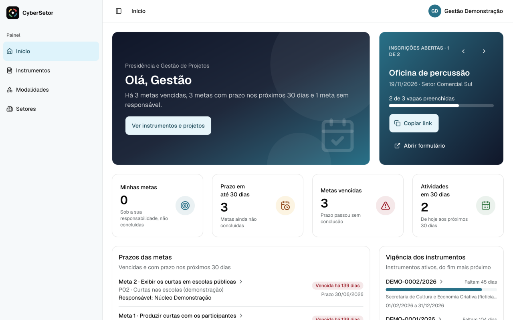
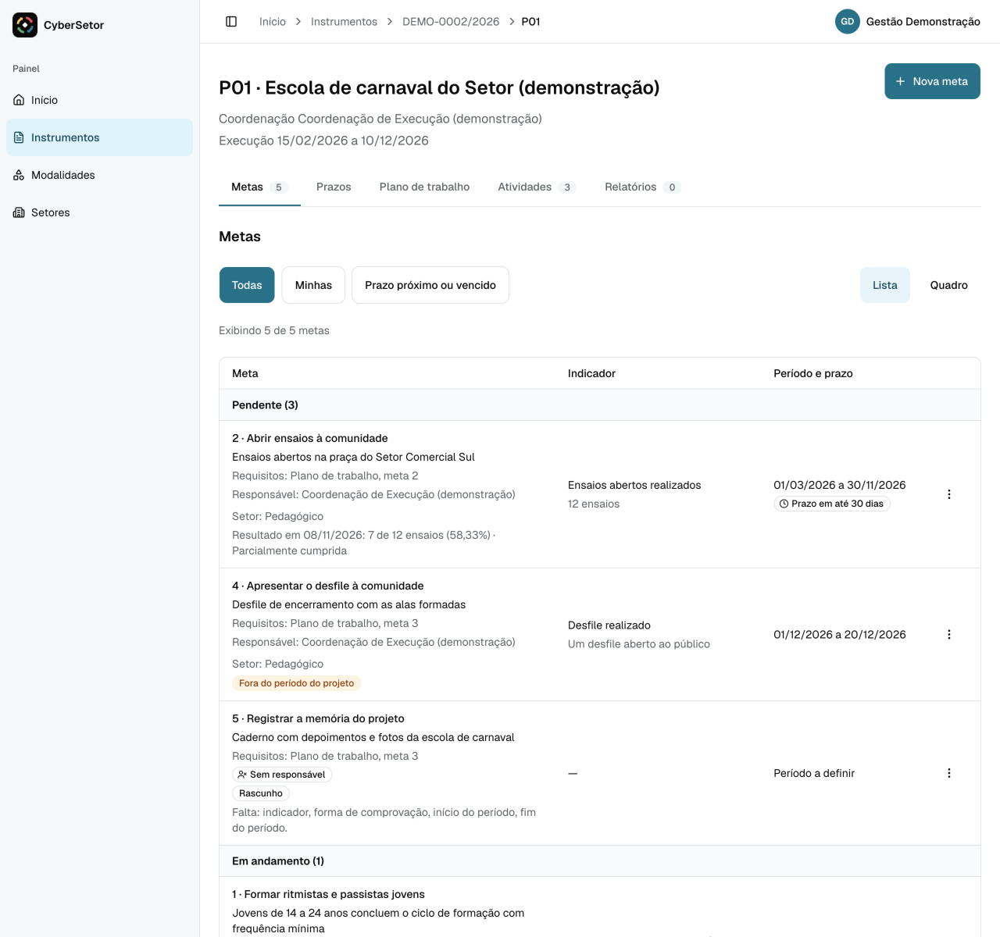
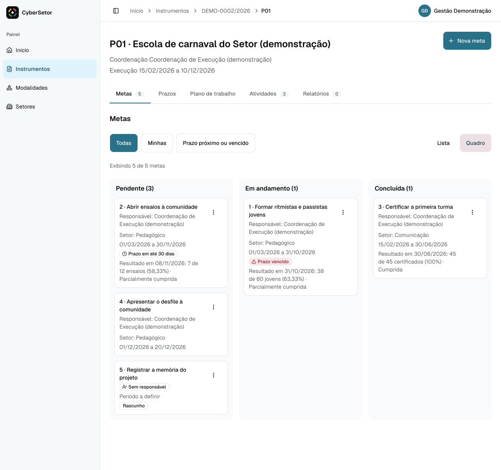
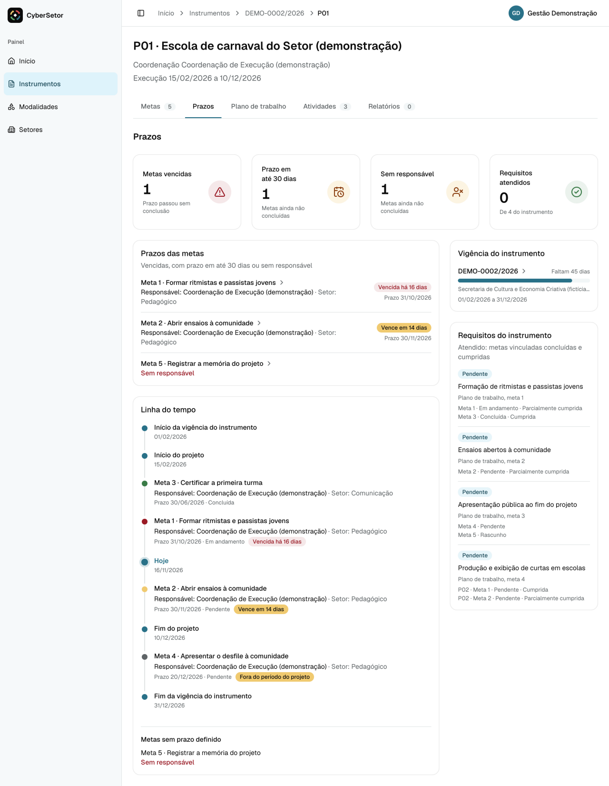
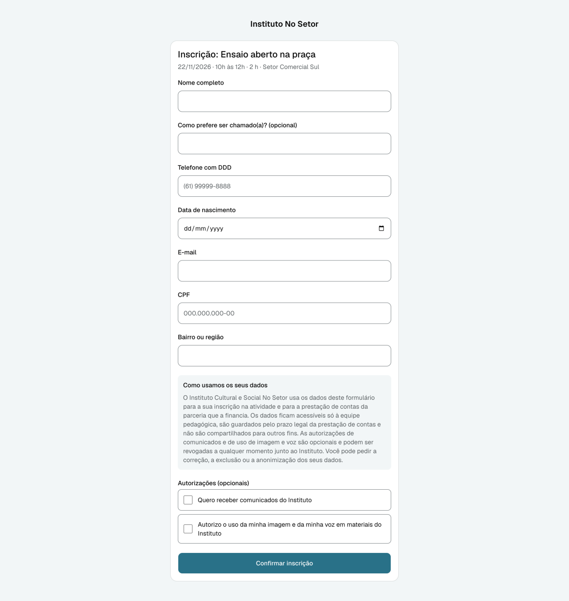
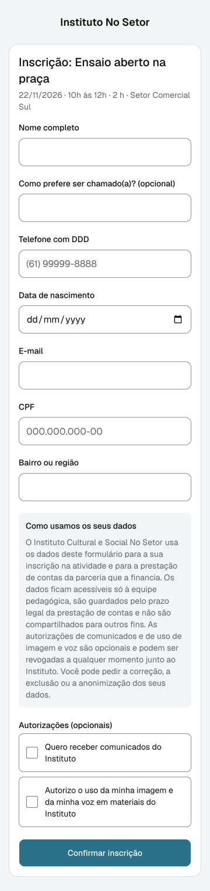
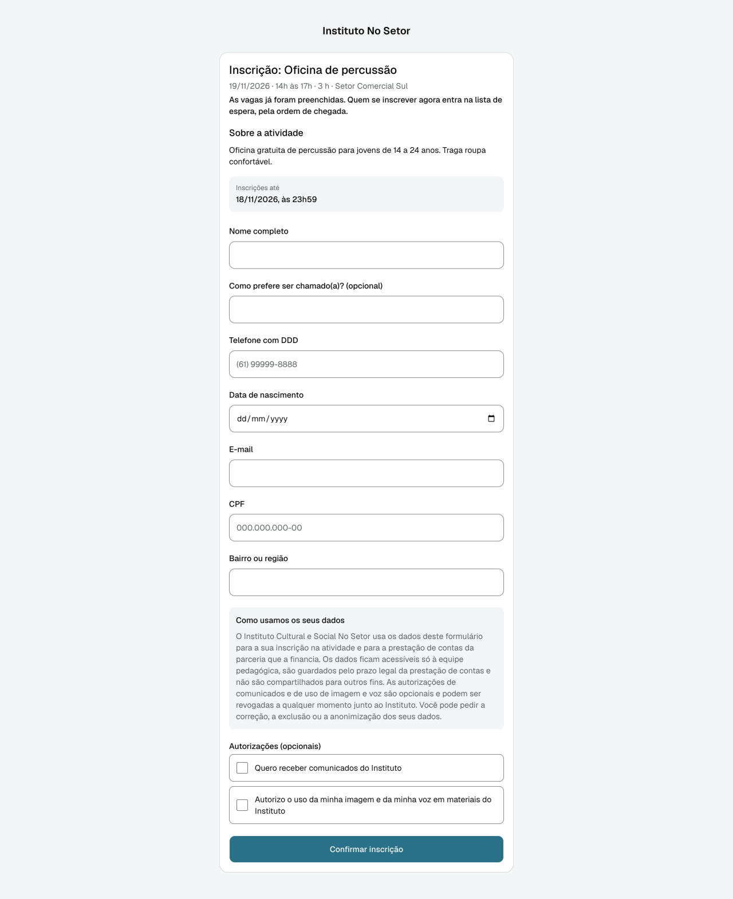
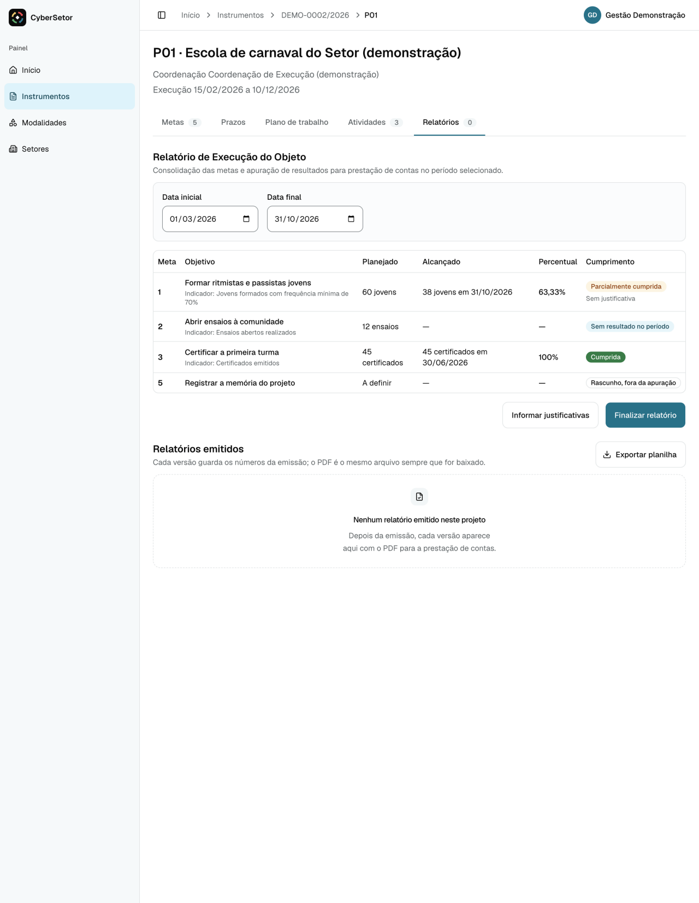
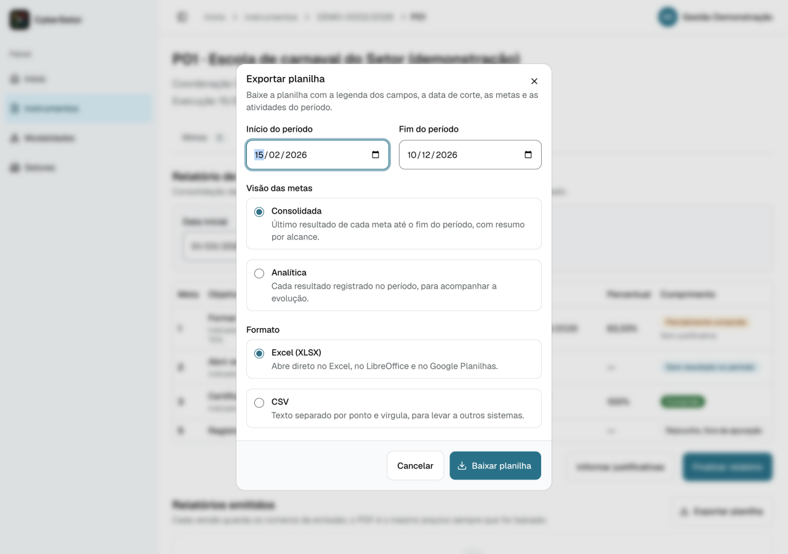

# Síntese de Entregas — Unidade 3

| Data | Versão | Descrição | Autor(es) |
| :--- | :--- | :--- | :--- |
| 16/11/2026 | 1.0 | Registro da entrega da Unidade 3: itens pedidos pelo docente com o lugar de cada um no site, evidências dos objetivos da unidade e situação na data da entrega | Maria Eduarda Marques |
| 16/11/2026 | 1.1 | Entrega durante a Sprint 5; revisão por dois integrantes desde 05/11; reunião de 12/11 na 10.2.8; medições do RNF12 e do RNF13; acesso à página das sprints | Vinicius Vieira |
| 16/11/2026 | 1.2 | Capturas das telas do ambiente de homologação com dados de teste, cada uma com a história que atende (ATA-2026-11-12, A5 e A14) | Vinicius Vieira |

---

## 1. Visão geral da entrega

Esta página registra a entrega de 17/11/2026, durante a [Sprint 5](../gestao/sprints/sprint-5.md), que termina em 19/11/2026. A Unidade 3 tem três objetivos: **representação**, **verificação e validação** e **organização e atualização** dos requisitos. Os documentos vigentes estão nas seções da Visão de Produto e Projeto e nas [seções 8](../requisitos/8-requisitos.md), [9](../requisitos/9-dor-dod.md) e [10](../requisitos/10-backlog.md). Esta página só indica onde cada item está.

- **Marcos:** MVP confirmado pelo Instituto em 08/10/2026; checkpoint na homologação em 29/10/2026; reunião de validação em 12/11/2026; entrega da Unidade 3 em 17/11/2026, com a tag `u3-2026-11-17`.
- **Catálogo vigente:** 46 requisitos funcionais, 20 requisitos não funcionais e 15 regras de negócio, com o recorte do MVP e dos incrementos na [seção 10.2.6](../requisitos/10-backlog.md#1026-mvp-e-incrementos).

---

## 2. Apresentação da Unidade 3

!!! warning "Vídeo a incluir 🔧"
    O vídeo de apresentação entra nesta seção antes da publicação de 17/11, com o link direto para o YouTube.

---

## 3. Itens da entrega

| Item pedido | Onde está |
| :--- | :--- |
| Visão de Produto e Projeto (atualizada) | [Visão de Produto e Projeto](../visao/index.md), seções 1 a 7, cada uma com o histórico de versões |
| Lista de RFs e RNFs | [8.2 Requisitos funcionais](../requisitos/8-requisitos.md#82-lista-de-requisitos-funcionais-rfs) e [8.3 Requisitos não funcionais](../requisitos/8-requisitos.md#83-lista-de-requisitos-nao-funcionais-rnfs) |
| Escopo do produto (backlog, itens de trabalho, mapa) | [10.1 Backlog geral](../requisitos/10-backlog.md#101-backlog-geral), [B1 — processo atual em BPMN](../requisitos/b1-bpmn-processo-atual.md) e o [quadro do projeto](https://github.com/orgs/mdsreq-fga-unb/projects/121) |
| Escopo priorizado e entregas definidas (MVP) | [10.2 Priorização e MVP](../requisitos/10-backlog.md#102-priorizacao-do-backlog-geral-e-mvp), [10.2.6 MVP e incrementos](../requisitos/10-backlog.md#1026-mvp-e-incrementos) e [6.3 Alcance do MVP](../visao/6-cronograma.md#63-alcance-do-mvp-e-o-que-fica-fora) |
| DoR e DoD | [9.1 DoR](../requisitos/9-dor-dod.md#91-definition-of-ready-dor) e [9.2 DoD](../requisitos/9-dor-dod.md#92-definition-of-done-dod) |
| Evidências de execução do processo (ESw e ER) | [Processo e ritos](../gestao/processo-scrumxp.md), [atas](../gestao/atas/index.md), [sprints](../gestao/sprints/index.md), com o plano e as tarefas de cada uma, [registro das dailies](../gestao/dailies.md), [seção 4](../visao/4-estrategia-esw.md) (ESw) e [seção 5](../visao/5-engenharia-requisitos.md) (ER) |
| Rastreabilidade (problema, OG, OEs, CPs, RFs e RNFs, declarações) | [8.4 Matriz de rastreabilidade](../requisitos/8-requisitos.md#84-matriz-de-rastreabilidade-bidirecional), [B1 — gargalos e capacidades](../requisitos/b1-bpmn-processo-atual.md#4-rastreabilidade-dos-gargalos-as-capacidades-previstas) e as fichas das histórias na [seção 10.1](../requisitos/10-backlog.md#101-backlog-geral) |
| Cumprimento e atualização do planejamento (cronograma) | [6.1 Calendário vigente](../visao/6-cronograma.md#61-calendario-vigente), [6.6 Marcos da disciplina](../visao/6-cronograma.md#66-marcos-da-disciplina) e os critérios de aceitação de cada plano de sprint |
| Site do projeto (GitHub Pages) | Este site, publicado a partir da branch `main` com a tag `u3-2026-11-17` |
| Vídeo de apresentação | [Seção 2 desta página](#2-apresentacao-da-unidade-3) 🔧 |

---

## 4. Objetivos da unidade e evidências

| Objetivo | O que a equipe fez | Evidência |
| :--- | :--- | :--- |
| **Representação de requisitos** | Requisitos em cartões com história, critérios de aceitação, origem e destino no MVP; matriz de rastreabilidade em trilhas; fichas completas por história; histórias reorganizadas com um ator e um resultado cada | [Seção 8](../requisitos/8-requisitos.md); [seção 10.1](../requisitos/10-backlog.md#101-backlog-geral); [ata de 20/10](../gestao/atas/2026-10-20-sprint-review-retrospectiva-planning.md) (D2) |
| **Verificação e validação** | DoR e DoD aplicadas a cada história; revisão de cada pull request por dois integrantes desde 05/11/2026; checkpoint com o Instituto na homologação, com dados de teste; reunião de validação de 12/11; avaliação da monitoria | [Seção 9](../requisitos/9-dor-dod.md); [10.2.8 Validação com o Instituto](../requisitos/10-backlog.md#1028-validacao-com-o-instituto); [6.5](../visao/6-cronograma.md#65-validacao-com-o-instituto); [ata de 12/11 (monitoria)](../gestao/atas/2026-11-12-reuniao-monitoria.md) |
| **Organização e atualização** | Backlog reestruturado; documentação reorganizada sem duplicação, com resumo nas seções longas; histórico de versões em cada página; respostas às issues do docente da Unidade 2; referências no sistema numérico | [Ata de 10/11](../gestao/atas/2026-11-10-reuniao-equipe.md); [ata de 12/11 (monitoria)](../gestao/atas/2026-11-12-reuniao-monitoria.md); [Referências](../referencias.md) |

---

## 5. Situação na data da entrega

- **MVP:** a Sprint 5 tem como meta o MVP completo em código; o registro de conclusão de cada história está no [quadro do projeto](https://github.com/orgs/mdsreq-fga-unb/projects/121) e o balanço sai na Sprint Review 5.
- **Validação com o Instituto:** a reunião de 12/11/2026 está registrada na [seção 10.2.8](../requisitos/10-backlog.md#1028-validacao-com-o-instituto), com a ata em conferência pelo Instituto; os retornos entram na Sprint Review 5, em 19/11/2026. Os valores ainda em conferência continuam marcados com 🔧.
- **Requisitos não funcionais:** o formulário público (RNF12) e o PDF do relatório (RNF13) foram medidos na homologação em 14/11/2026 e atendem às métricas, com tempo máximo de 1,78 s e de 2,13 s; as medições das consultas agregadas (RNF11), de acessibilidade e de navegadores seguem o [plano da Sprint 5](../gestao/sprints/sprint-5.md#62-sprint-backlog).
- **Issues do docente da Unidade 2:** respondidas no repositório; o fechamento é do docente.
- **Lições aprendidas:** [11. Lições aprendidas — Unidade 3](../licoes-aprendidas/unidade-3.md).

---

## 6. Ambiente de homologação com dados de teste

Retrato do ambiente de homologação em 16/11/2026, com o MVP desta unidade, os dados fictícios e as contas de teste usados nas validações com o Instituto ([política de dados de teste](../visao/2-solucao-proposta.md#dados-de-teste)). São os fluxos que o Instituto percorreu no checkpoint de 29/10/2026 e na reunião de validação de 12/11/2026. Cada tela traz a história de usuário que ela atende; a ficha da história, na seção 10.1, segue como a referência vigente. A interface continua evoluindo nos próximos incrementos.

**Painel inicial, perfil de gestão ([HU-02b](../requisitos/10-backlog.md#hu-02b)).** Metas vencidas e com prazo nos próximos 30 dias, inscrições abertas e vigência dos instrumentos.

**Metas do projeto em lista ([HU-01b](../requisitos/10-backlog.md#hu-01b), [HU-02a](../requisitos/10-backlog.md#hu-02a)).** Indicador, período, responsável, setor e resultado alcançado de cada meta; a meta incompleta aparece como rascunho, com o que falta.

**Metas do projeto no quadro ([HU-02a](../requisitos/10-backlog.md#hu-02a)).** As mesmas metas agrupadas por situação.

**Prazos do projeto ([HU-02b](../requisitos/10-backlog.md#hu-02b)).** Linha do tempo com os prazos das metas e a vigência.

**Formulário público de inscrição ([HU-07a](../requisitos/10-backlog.md#hu-07a), [HU-07d](../requisitos/10-backlog.md#hu-07d)).** Aberto por link ou QR Code, sem conta nem senha, no computador e no celular.

**Inscrição com as vagas preenchidas ([HU-07c](../requisitos/10-backlog.md#hu-07c)).** O formulário avisa que a pessoa entra na lista de espera.

**Relatório de execução e planilha ([HU-05a](../requisitos/10-backlog.md#hu-05a), [HU-13](../requisitos/10-backlog.md#hu-13)).** Prévia das metas do período e exportação dos dados do projeto em planilha.

