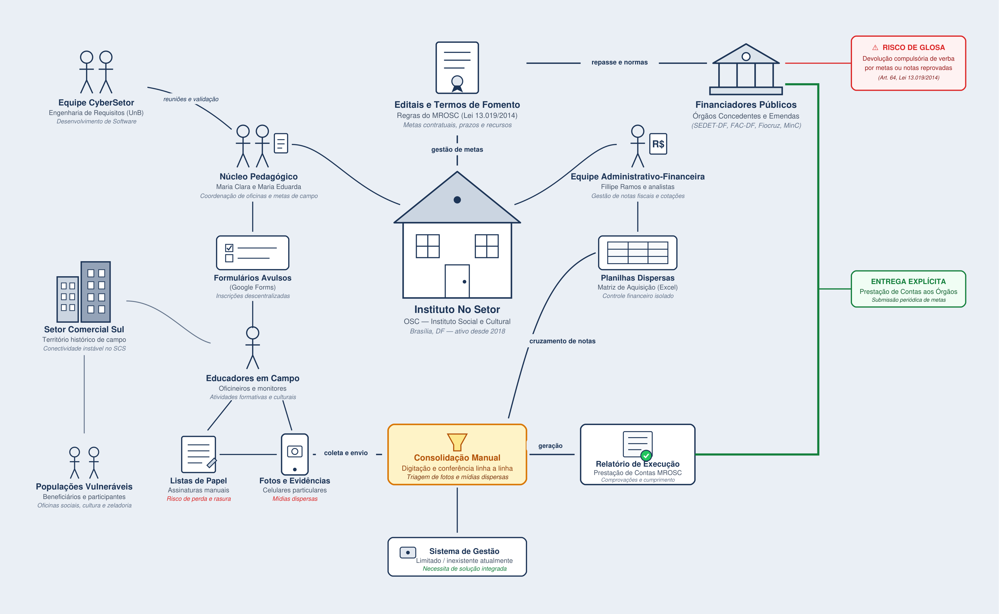
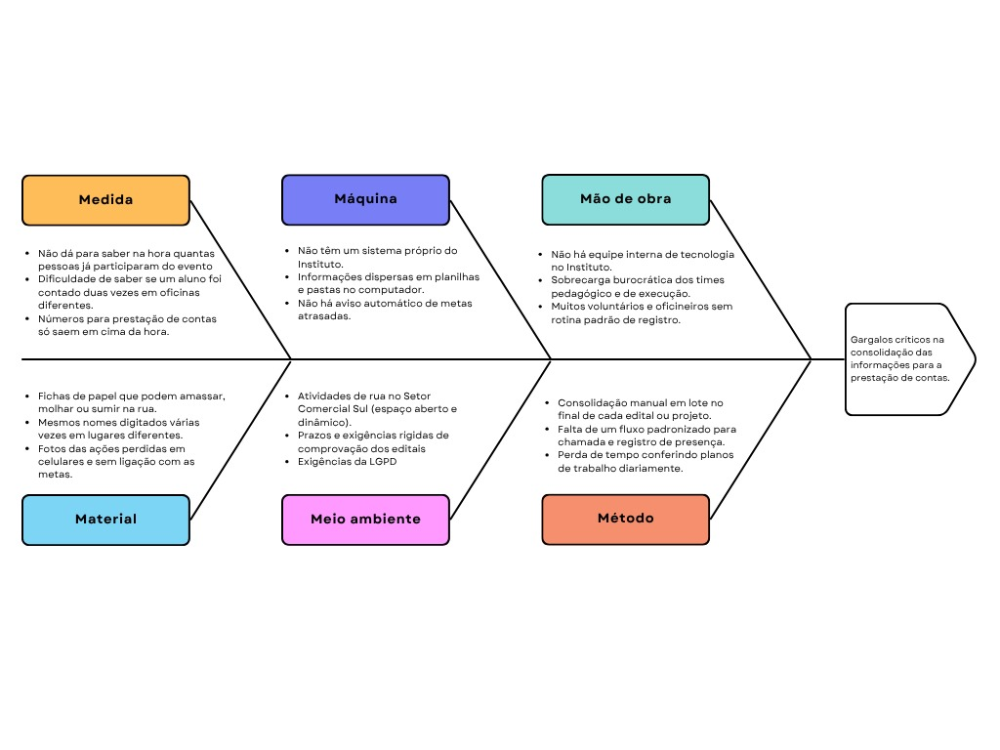
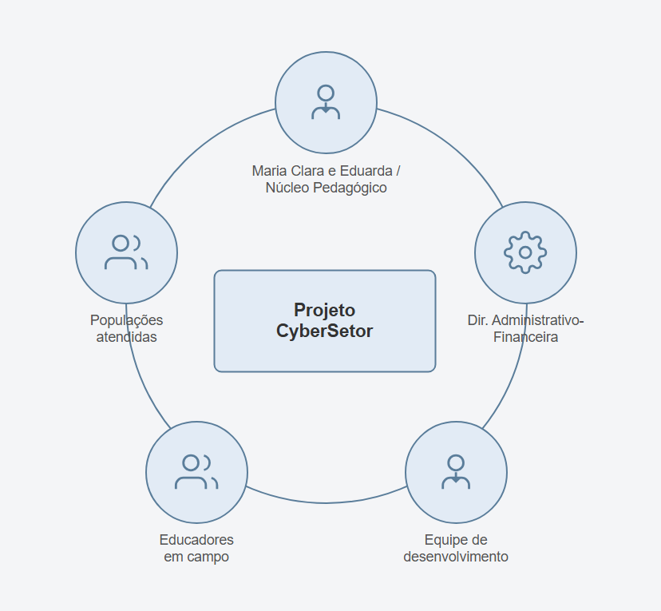

# 1. Cenário atual do cliente e do negócio

| Data | Versão | Descrição | Autor(es) |
| :--- | :--- | :--- | :--- |
| 01/09/2026 | 1.0 | Versão inicial | Equipe CyberSetor |
| 05/09/2026 | 1.1 | Revisão das seções 1.4, 1.5 e 1.7 | Equipe CyberSetor |
| 14/09/2026 | 1.2 | Identificação institucional das representantes do Instituto nas seções 1.1, 1.5 e 1.6; mapa de stakeholders alinhado à validação por área da seção 7.3.1 | Vinicius Vieira e Maria Eduarda Marques |
| 17/09/2026 | 1.3 | Segmentação de clientes alinhada ao escopo da seção 2.3: registro de presença e carga horária no lugar da emissão de certificado | Equipe CyberSetor |
| 17/09/2026 | 1.4 | Dimensionamento do problema, matriz de interesse e poder com estratégias de engajamento, distinção entre usuário, titular e beneficiário, aprofundamento da área administrativo-financeira e heterogeneidade dos editais | Rodrigo Henrique e Daniel Batista |
| 28/09/2026 | 1.5 | Rich Picture refeito com os oito componentes do fluxo operacional (financiadores públicos, editais e termos de fomento, projetos e metas, formulários avulsos, campo com listas e fotos, área administrativo-financeira, consolidação manual e entrega dos relatórios com risco de glosa), detalhados na seção 1.3 | Daniel Batista |
| 30/09/2026 | 1.6 | Atualização do Rich Picture e mapa de stakeholders com papéis identificados na reunião de 08/09 (Diretoria de Projetos, Captação de Recursos, ausência de RH, demais setores operacionais e regimes de financiadores) | Equipe CyberSetor |
| 05/10/2026 | 1.7 | Fechamento do dimensionamento empírico com estimativas da coordenação, restauração do mapa circular de stakeholders e unificação da matriz de interesse e poder | Rodrigo Henrique |
| 26/10/2026 | 1.8 | Conectividade no campo com quedas pontuais (1.3 e 1.5); área administrativo-financeira com a rotina atual fora do sistema e a consulta a consolidados e relatórios, sem dados nominais (1.6 e 1.7); painel da presidência como capacidade candidata sem requisito funcional, sem saldo (1.7); desafios de conectividade, de dados pessoais e de manutenção com remissão às políticas da seção 2.6 (1.5) | Vinicius Vieira |
| 11/11/2026 | 1.9 | Resumo do problema no início da 1.4; relatório próprio com remissão à 2.3 e ao incremento 2 do índice de comprovações (1.5); painel gerencial como capacidade candidata (1.6) | Maria Eduarda Marques |
| 16/11/2026 | 1.10 | Números da 1.4 como estimativas da coordenação, a confirmar com os dados do projeto piloto | Vinicius Vieira |
| 16/11/2026 | 1.11 | Seção enxugada: fluxo do Rich Picture em etapas, dimensionamento em cartões, matriz de interesse e poder em quadrantes e segmentos em cartões, sem repetir as políticas da seção 2.6 | Vinicius Vieira |

## 1.1 Identificação do Cliente/Parceiro

* **Instituição:** Instituto Cultural e Social No Setor (Instituto No Setor), Organização da Sociedade Civil (OSC) sem fins lucrativos, regida pelo Marco Regulatório das Organizações da Sociedade Civil, MROSC (Lei Federal nº 13.019/2014).
* **Interlocutores:**
    * *Presidência:* Rafael, com a visão consolidada das operações e das parcerias.
    * *Núcleo pedagógico:* Maria Clara e Maria Eduarda. **Não confundir com Maria Eduarda Marques, integrante da equipe CyberSetor (seção 7.1).**
    * *Coordenação e rotina administrativo-financeira:* Fillipe Ramos.
    * *Área de projetos:* Fran.
* **Canais:** reuniões presenciais e remotas, grupo institucional no WhatsApp e correio eletrônico.
* **Papel no projeto:** clientes e especialistas de domínio. Descrevem a rotina, fornecem amostras dos instrumentos de gestão, priorizam funcionalidades e validam as entregas.

## 1.2 Introdução ao Negócio e Contexto

Há cerca de oito anos, o Instituto ocupa democraticamente o espaço público e defende o direito à cidade, a partir da sede histórica no Setor Comercial Sul (SCS), em Brasília. Dos eventos culturais e ocupações artísticas (Setor Carnavalesco Sul, SCS Tour) passou, sobretudo desde a pandemia de Covid-19, à assistência humanitária, zeladoria urbana, capacitação técnica e promoção de direitos humanos para populações em extrema vulnerabilidade.

Financiam essas ações parcerias distritais e federais (SEDET-DF, FAC-DF, Fiocruz, Ministério da Cultura) e emendas parlamentares, com prestação de contas rigorosa. Os dados, porém, vivem em controles manuais e planilhas desconexas, o que expõe o Instituto a inexecução e sanções.

## 1.3 Rich Picture e Mapeamento do Fluxo do Problema

<figure markdown>
  
  <figcaption>Figura 1 – Rich Picture do Cenário Operacional do Instituto No Setor. Fonte: elaborada pelos autores.</figcaption>
</figure>

O Rich Picture mostra os oito componentes do fluxo operacional, do repasse ao risco de glosa:

1. **Financiadores públicos.** Órgãos concedentes e emendas parlamentares (seção 1.2), cada um com seu regime; repassam recursos e fiscalizam as metas.
2. **Editais e termos de fomento.** Instrumentos do MROSC que fixam metas, prazos, limites orçamentários e regras de prestação de contas.
3. **Diretoria de Projetos e Captação.** Capta emendas, conduz a prestação de contas e as emergências e desdobra os termos em planos de trabalho.
4. **Formulários avulsos.** Inscrições e cadastros do núcleo pedagógico em Google Forms, sem base central.
5. **Campo: presença e evidências.** Educadores, oficineiros e setores operacionais (marcenaria, lavanderia, estilografia, atendimento a pessoas em situação de rua) atuam no espaço público, com conexão não garantida e quedas pontuais; listas em papel e fotos em celulares pessoais.
6. **Administrativo-financeiro.** Cotações, notas fiscais e Matriz de Aquisição em Excel, sem ligação com as evidências; sem área de RH, acumula também a gestão de pessoal.
7. **Consolidação manual.** Gargalo: digitação das listas, triagem de fotos e conferência linha a linha com as rubricas.
8. **Relatório e risco de glosa.** Relatório de cumprimento do objeto entregue ao financiador; o atraso e a fragilidade expõem à glosa e à devolução de recursos (art. 64 da Lei 13.019/2014).

O fluxo está modelado em BPMN na página [B1 · Modelo do processo atual](../requisitos/b1-bpmn-processo-atual.md).

## 1.4 Identificação e Dimensionamento Empírico do Problema

**Em resumo.** Pelas estimativas da coordenação, o Instituto gere de 4 a 6 projetos e termos de fomento com 20 a 30 planilhas, listas em papel e fotos em celulares pessoais; a consolidação manual consome de 30 a 50 horas por ciclo e só revela metas em atraso no fechamento, com risco de glosa.

<figure markdown>
  
  <figcaption>Figura 2 – Diagrama de Ishikawa. Fonte: elaborada pelos autores.</figcaption>
</figure>

Estimativas da coordenação nas reuniões de elicitação, em ordem de grandeza, a confirmar com os dados do projeto piloto:

- **4 a 6 projetos em paralelo**

    Termos de fomento simultâneos; no ciclo atual, códigos operacionais 061 a 065 e 068.

- **20 a 30 planilhas por ciclo**

    Turmas, frequências de oficineiros e Matriz de Aquisição, em drives pessoais, sujeitas a inconsistência e exclusão acidental.

- **10 a 20 oficinas e eventos por mês**

    Serigrafia, fotografia, música, arte urbana e zeladoria; de 300 a 800 participantes por mês, milhares de atendimentos no ano.

- **Mais de 1.500 fotos e vídeos por semestre**

    Em celulares particulares, com dezenas de listas de frequência em papel sujeitas a rasura, umidade e extravio.

- **30 a 50 horas por prestação de contas**

    Digitação das listas e checagem cruzada com as rubricas orçamentárias.

- **Atraso visto só no fechamento**

    Sem acompanhamento durante a execução, não há tempo para termo aditivo, e cresce o risco de glosa (art. 64 da Lei 13.019/2014).

- **Editais e plataformas diferentes**

    Cada concedente tem exigências, plataforma (TransferGov, sistema Parcerias) e modelos próprios.

## 1.5 Desafios do Projeto

- **Campo com conexão não garantida**

    Interface leve para registrar presença e evidências no espaço público, com quedas pontuais ([seção 10.2.2](../requisitos/10-backlog.md#1022-avaliacao-de-negocio-com-o-instituto)). Política: [operação sem conexão](2-solucao-proposta.md#politica-sem-conexao).

- **Dados pessoais e LGPD**

    Dados de crianças, adolescentes e pessoas vulneráveis restritos ao núcleo pedagógico. Política: [dados pessoais](2-solucao-proposta.md#politica-dados-pessoais).

- **Autonomia e manutenção**

    Operação diária sem equipe interna de tecnologia; administração e custeio após a disciplina são dependências reais. Política: [transferência](2-solucao-proposta.md#politica-transferencia).

- **Variedade de editais**

    Relatório consolidado próprio, com exportação tabular e índice de comprovações (incremento 2, [seção 10.2.6](../requisitos/10-backlog.md#1026-mvp-e-incrementos)), sem reproduzir o formulário de cada concedente ("Sobre a CP8", [seção 2.3](2-solucao-proposta.md#23-caracteristicas-de-produto-mapeadas-com-os-objetivos-especificos-do-produto)).

## 1.6 Mapa e Matriz de Stakeholders

Quatro categorias evitam ambiguidade de governança e de LGPD: **usuários** (operam o sistema), **titulares** (têm dados cadastrais ou fotos tratados), **beneficiários** diretos e indiretos (populações e comunidade atendidas) e **externos** (concedentes que normatizam e auditam).

<figure markdown>
  
  <figcaption>Figura 3 – Mapa de stakeholders do projeto CyberSetor. Fonte: elaborada pelos autores.</figcaption>
</figure>

### 1.6.1 Matriz de Interesse e Poder

Quadrantes com a estratégia de engajamento. A área que valida cada conjunto de funcionalidades está na [seção 7.3.1](7-equipe-e-cliente.md#731-area-competente-por-funcionalidade).

- **Gerenciar de perto** · poder alto, interesse alto

    - *Financiadores públicos:* alinhamento prioritário e relatórios auditáveis, para afastar a glosa.
    - *Presidência e Diretoria Executiva* (Rafael): prioridades do produto e painel gerencial (capacidade candidata, sem requisito funcional).
    - *Diretoria de Projetos e Captação* (Fran): validação do modelo de metas, indicadores e aferição.
    - *Equipe CyberSetor:* engenharia de requisitos e entregas quinzenais.

- **Manter satisfeito** · poder médio, interesse alto

    - *Coordenação administrativo-financeira* (Fillipe Ramos): valida o relatório de execução do objeto (seção 7.3.1); uso no sistema na seção 1.7.
    - *Núcleo pedagógico* (Maria Clara e Maria Eduarda): validação contínua das telas de campo, das atividades e das evidências.

- **Manter informado** · poder baixo, interesse alto

    - *Educadores, oficineiros e setores operacionais:* capacitação no registro de presença pelo celular e no envio de fotos.

- **Monitorar** · poder baixo, interesse médio ou baixo

    - *Participantes das oficinas* (titulares, interesse médio): consentimento transparente e direito de retificação e exclusão.
    - *Populações vulneráveis e comunidade* (beneficiários, interesse baixo): proteção dos dados sensíveis, dados agregados e acolhimento sem barreira digital.

## 1.7 Segmentação de Clientes e Usuários

- **1. Presidência e Diretoria Executiva**

    Decide sobre vários projetos. Consultaria o painel consolidado de metas e cronograma, capacidade candidata sem requisito funcional ([seção 8.6](../requisitos/8-requisitos.md#86-pontos-em-aberto-e-auditoria-de-lacunas), item 1).

- **2. Diretoria de Projetos**

    Coordena as parcerias com o setor público. Cadastra requisitos e metas do instrumento, atribui responsável e prazo a cada meta e gera o Relatório de Execução do Objeto.

- **3. Coordenação Administrativo-Financeira**

    Cotações, tomada de preços, cartas-convite, contratos e pagamentos (*TransferGov*, *Internet Banking*). A Matriz de Aquisição, a conformidade de fornecedores e as rubricas ficam fora do sistema: o controle financeiro não integra o produto. Consulta instrumentos, metas, consolidados de presença e evidências e relatórios, sem dados nominais ([seção 8.5.1](../requisitos/8-requisitos.md#851-perfis-de-acesso-e-permissoes)).

- **4. Educadores, artistas e voluntários de campo**

    Atendem no SCS. Usam o navegador do celular para conferir presença, enviar fotos ligadas à atividade e registrar ocorrências.

- **5. Participantes das oficinas**

    Crianças, jovens e adultos inscritos. Só usam a página pública de inscrição e os termos de consentimento de dados e imagem.

- **6. Populações vulneráveis e comunidade**

    Pessoas em situação de rua e frequentadores das ações de zeladoria, saúde e alimentação. Não usam o sistema; os atendimentos entram de forma agregada e anônima, lançados pelos facilitadores de campo.

